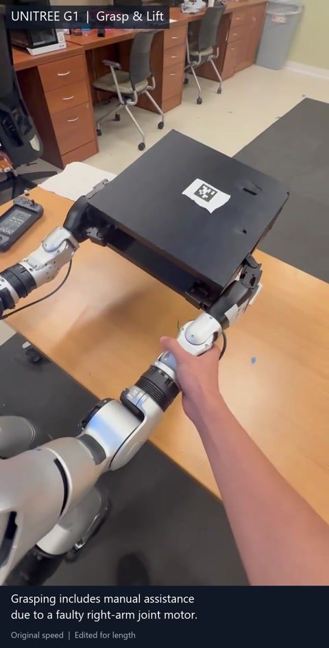

# Vision-Guided Dual-Arm Manipulation on Unitree G1

A Python perception-to-execution stack for **vision-guided dual-arm pick-and-place**
on a Unitree G1 humanoid. The system connects RealSense/AprilTag perception,
inverse kinematics, collision-aware RRT-Connect planning, and arm/hand execution
on an onboard **Jetson Orin NX**, with **no ROS at runtime**.

Developed by **Raymond Feng** in the **WashU Humanoid Robotics Lab**
(Prof. Yiannis Kantaros).

## Hardware demo

<a href="https://github.com/raymond-feng26/g1_arm_motionplanning-rrt/blob/main/assets/G1_DualArm_Demo.mp4">
  
</a>

[Watch the 19.8-second demo (MP4)](assets/G1_DualArm_Demo.mp4)

Original-speed footage of grasping, lifting, placing, and retracting.
During this recording, a fault in another right-arm joint motor required a
manual push. This was separate from the locked wrist-yaw constraint described
below. The video preserves and labels the manual assistance.

## My contributions

- **Perception and grasp geometry:** integrated RealSense D435i and AprilTag
  detection, camera-to-robot coordinate transforms, and box/table geometry to
  generate dual-arm grasp targets from a live scene snapshot.
- **Planning and kinematics:** implemented KD-tree-accelerated RRT-Connect,
  capsule-vs-box collision checking, and analytical-Jacobian inverse kinematics
  for the two 7-DOF arms.
- **Hardware execution:** integrated 100 Hz joint-command execution with
  Pinocchio gravity-compensation feedforward, coordinated the dex3 hands, and
  accommodated a failed wrist-yaw actuator through a fixed-joint constraint
  shared by IK, planning, and execution.

## Selected results

These are measurements from the project hardware and IK tests.

| Measurement | Result |
|---|---|
| Analytical-Jacobian IK versus numerical-Jacobian IK | Approximately **5x faster** |
| End-effector error with gravity compensation | Reduced from approximately **20 mm to 6.5 mm** |
| Joint-command execution | **100 Hz** on the G1 hardware |

## Implemented behaviors

An onboard RealSense D435i observes two AprilTags: one on the box and one on
the table. The stack supports:

- **Grab + lift:** approach, close in, grip, and lift with both arms.
- **Put down + push:** place and release the box, then nudge it to the robot's right.
- **Pull-left approach:** reach toward a box on the robot's right. The drag step
  is staged but currently disabled while post-drag hand extraction is developed.

A ROS 2 / MoveIt 2 prototype preceded this custom runtime. For calibration,
tuning, troubleshooting, and implementation details, see
[DEVELOPMENT.md](DEVELOPMENT.md).

---

## Two entry points

```bash
python grab_run.py        # grab → lift → (optional) put-down + push right
python pull_left_run.py   # approach/reach a far-right box; drag is disabled
```

## How it works

Two processes on the Jetson talk over a local TCP socket. In this deployment,
`pyrealsense2` is built for Python 3.8, so perception runs in a Docker container
while planning/execution runs in a Python 3.12 conda environment.

```
[Docker / Py3.8]  RealSense → AprilTag detect → solvePnP → T_optical_tag
        │  socket :5000
[conda / Py3.12]  perception_client → camera_calib → grasp_scene.snapshot_scene
                  → G1DualArm IK (14-DOF) → g1_plan_run.plan (RRT-Connect+shortcut)
                  → g1_choreograph.run_sequence → G1 arm/hand controllers
                                              │  unitree_sdk2py / CycloneDDS
                                              ▼  the robot moves
```

Every run snapshots the scene **once** (box + table poses, four grasp targets,
and two obstacle worlds — box-present and box-dropped), validates IK up front,
and only then plans and executes behind a confirm gate.

## Repo layout

| File | Role |
|---|---|
| `grab_run.py`, `pull_left_run.py` | **Entry points** — the two behaviors |
| `grasp_scene.py` | Shared front-end: tag snapshot → `Scene`, IK-validate, plan-HTML |
| `choreographies.py` | Runtime step builders: `build_grab` / `build_put_down` / `build_pull_left` |
| `g1_choreograph.py` | Choreography engine (`run_sequence`, `preflight_validate`) |
| `g1_plan_run.py` | Planning helpers: `plan` (RRT-Connect), `_validate`, obstacles, HTML |
| `rrt_planner.py`, `kdtree.py` | RRT-Connect + nearest-neighbor KD-tree |
| `myArm_v2.py`, `myArm_dual.py` | 7-DOF and 14-DOF kinematics, collision, analytical-Jacobian IK |
| `gravity_comp.py` | Pinocchio gravity feed-forward |
| `apriltag_pose_server.py` | Perception server (runs in the Docker container) |
| `perception_client.py`, `camera_calib.py`, `grasp_target.py` | Client, camera extrinsic, box/table geometry |
| `g1_robot.py`, `g1_arm_controller.py`, `g1_hand_controller.py`, `g1_arm_live_tuner.py` | Hardware layer |
| `g1_29dof_with_hand.urdf` | Robot model |
| **`DEVELOPMENT.md`** | **Full runbook, per-parameter tuning tables, calibration, troubleshooting** |

## Requirements

- **Hardware:** Unitree G1 (dual 7-DOF arms, dex3 hands), RealSense D435i, Jetson Orin NX.
- **Planning env (conda, Python 3.12):** `numpy`, `ikpy`, `pinocchio`, `unitree_sdk2py`, CycloneDDS.
- **Perception (Docker, Python 3.8):** `pyrealsense2`, `pupil-apriltags`, `opencv`.
  See `DEVELOPMENT.md` for the one-time image build.

## Quick start

```bash
# 0. Pre-position the right wrist (RWY) by hand — its motor is locked (see below).

# Terminal 1 — perception (Docker):
docker run -it --rm --network host --privileged -v /dev:/dev -v $(pwd):/work realsense:pyrs2 bash
python3 /work/apriltag_pose_server.py        # leave running

# Terminal 2 — the grab (conda):
conda activate base
python grab_run.py
```

## Notes

- **The right wrist-yaw motor is mechanically locked.** Its angle is read live at
  startup and pinned as a zero-width joint limit that IK/collision/planning honor.
  Pre-position it by hand before each run. Details in `DEVELOPMENT.md`.
- **Scope:** grab and put-down + push are implemented. Pull-left currently
  approaches and reaches in; its drag step remains staged-but-disabled while
  post-drag hand extraction is designed. Walking is out of scope.
- **Tuning:** every knob (tag sizes, camera extrinsic, box/table geometry, grasp
  offsets, speeds, per-phase dwell) is documented with defaults in `DEVELOPMENT.md`.

## License

No license yet — add one before sharing publicly if you intend others to reuse it.
